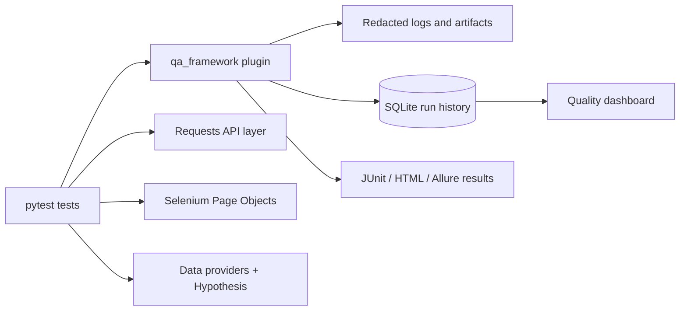

# Pytest Quality Lab

A production-style QA automation framework built with Python and pytest. It combines
API testing, Selenium UI automation, example-based and property-based data testing,
failure diagnostics, and multi-run quality analytics in one portfolio-ready project.

## Highlights

- Offline-first framework self-tests plus controlled local API and browser demos.
- Requests API layer with injectable transports, schema validation, and safe logging.
- Selenium Page Objects with explicit waits and automatic screenshot/page-source capture.
- Data-driven tests from CSV, JSON, YAML, and XLSX.
- Hypothesis property-based tests for invariants and edge cases.
- Isolated environment overrides that restore process state after every test.
- Redacted logs and Python tracebacks that preserve the original test failure.
- SQLite run history and a static quality dashboard for pass rate, flaky rate,
  execution time, requirement coverage, and failure history.
- JUnit, pytest-html, and Allure-compatible results.
- GitHub Actions quality, local browser, and opt-in external demo jobs.

## Architecture



## Requirements

- Python 3.10 or newer.
- Chrome for local Selenium tests. Firefox is also supported through `--browser`.
- Postman CLI is optional; its integration test is skipped when the CLI is unavailable.
- Allure CLI is optional. The Python adapter can generate raw results without it.

## Installation

```bash
git clone https://github.com/huynguyentan17042004/pytest-quality-lab.git
cd pytest-quality-lab

python3 -m venv .venv
source .venv/bin/activate
python -m pip install --upgrade pip
python -m pip install -e '.[dev,allure]'
```

Windows PowerShell activation:

```powershell
.venv\Scripts\Activate.ps1
```

## Run the tests

Run the complete local suite:

```bash
python -m pytest -q
```

Run deterministic unit tests without browser or Internet access:

```bash
python -m pytest tests/framework/unit -q
```

Run property-based tests:

```bash
python -m pytest -m property -v
```

Run one data-driven Selenium case in a visible Chrome window:

```bash
python -m pytest \
  'tests/ui/test_local_login_data_driven.py::test_local_login_partitions[DEMO-LOCAL-UI-001]' \
  --browser=chrome --headed -v
```

Useful pytest flags:

| Flag | Purpose |
| --- | --- |
| `--env=local` | Select `configs/environments/<name>.toml`. |
| `--browser=chrome` | Select Chrome or Firefox. |
| `--headed` | Show the browser instead of running headless. |
| `--timeout=10` | Override the framework HTTP/UI wait timeout. |
| `--run-external` | Explicitly allow the approved public demos. |
| `--analytics-db=PATH` | Store run history in another SQLite file. |
| `--no-analytics` | Run without writing quality history. |
| `-x --tb=short` | Stop on the first failure and use a compact traceback. |
| `--lf` | Re-run tests that failed in the previous pytest invocation. |

## Reports and quality dashboard

Each normal pytest run updates:

```text
artifacts/analytics/quality.db
artifacts/analytics/dashboard.html
artifacts/runs/<run-id>/
```

Generate all standard result formats:

```bash
python -m pytest -q \
  --html=artifacts/report.html \
  --self-contained-html \
  --junitxml=artifacts/junit.xml \
  --alluredir=artifacts/allure-results
```

Open the dashboard on macOS:

```bash
open artifacts/analytics/dashboard.html
```

Regenerate it from the existing SQLite history:

```bash
qa-dashboard \
  --db artifacts/analytics/quality.db \
  --output artifacts/analytics/dashboard.html \
  --requirements configs/requirements.yaml
```

With Allure 3 installed, generate its report from the raw results:

```bash
allure generate artifacts/allure-results
```

## Controlled failure demonstration

The following demo intentionally returns exit code `1`. It verifies traceback logging,
secret redaction, screenshot capture, page-source capture, and failure-history storage:

```bash
python -m pytest demos/controlled_failure/test_ui_failure.py -v
```

Inspect the newest directory under `artifacts/runs/` afterward. Generated artifacts,
virtual environments, caches, and local secrets are ignored by Git.

## External demonstrations

External tests are disabled by default. To run exactly the two allowlisted demos:

```bash
export SAUCE_DEMO_PASSWORD='<demo password>'
python -m pytest \
  tests/api/test_posts_api.py \
  tests/ui/test_locked_out_login.py \
  --env=qa --run-external --maxfail=1 -q
```

Do not place passwords or tokens in command-line arguments or committed configuration.
Copy `.env.example` to `.env` for local-only values; `.env` is ignored.

## Project structure

```text
src/qa_framework/       Reusable framework package
tests/framework/        Unit, property, and controlled integration self-tests
tests/support/          Demo application clients, models, and Page Objects
tests/api/              Local and opt-in external API demos
tests/ui/               Data-driven local and opt-in external UI demos
tests/integration/      Cross-layer application workflows
configs/                Environment and requirement catalogs
demos/                  Intentional failure demonstrations
docs/                   Architecture and usage documentation
postman/                Executable Postman collections
```

## Verified baseline

The latest local verification collected 55 tests: 52 passed and 3 were intentionally
skipped because external access was not enabled and Postman CLI was not installed.
Ruff, mypy, and dependency consistency checks also passed.

## Documentation

- [Architecture](docs/architecture.md)
- [API testing](docs/api-testing.md)
- [UI testing](docs/ui-testing.md)
- [Data-driven testing](docs/data-driven.md)
- [Property-based testing](docs/property-based-testing.md)
- [Quality analytics](docs/quality-analytics.md)
- [Allure integration](docs/allure.md)
- [CI/CD](docs/ci-cd.md)
- [Contributing](docs/contributing.md)

## Safety defaults

- Local and deterministic tests run by default.
- Public endpoints require `--run-external` and are restricted to approved cases.
- Secrets are redacted from framework-managed logs, tracebacks, subprocess output,
  and SQLite diagnostics.
- Supporting artifact failures never replace the original pytest failure.
