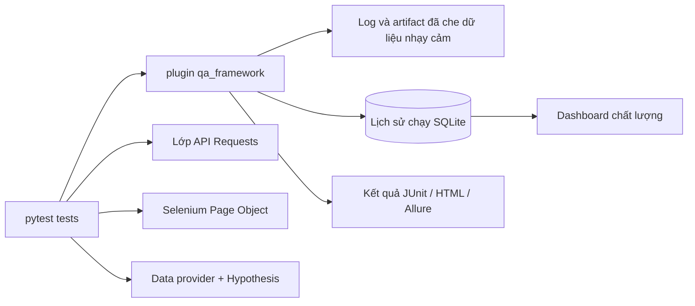
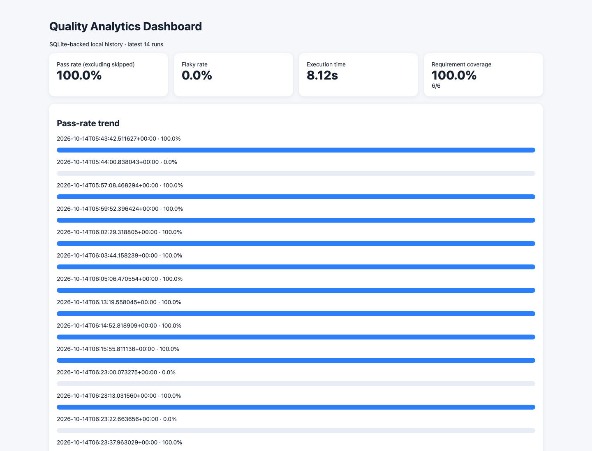
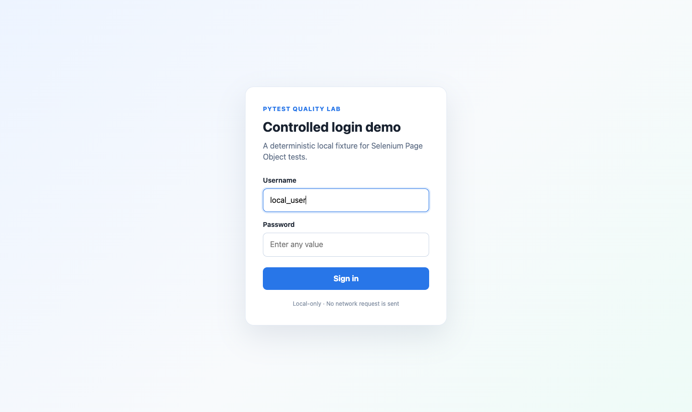

# Pytest Quality Lab

Framework tự động hóa kiểm thử theo hướng production, được xây dựng bằng Python và
pytest. Dự án kết hợp kiểm thử API, tự động hóa UI bằng Selenium, kiểm thử hướng dữ
liệu và property-based, chẩn đoán lỗi, cùng phân tích chất lượng qua nhiều lần chạy
trong một repository có thể sử dụng ngay.

## Điểm nổi bật

- Bộ self-test offline-first, kèm các demo API và trình duyệt chạy cục bộ có kiểm soát.
- Lớp API dựa trên Requests, hỗ trợ thay transport, kiểm tra schema và logging an toàn.
- Selenium Page Object với explicit wait và tự động chụp ảnh/page source khi thất bại.
- Đọc dữ liệu kiểm thử từ CSV, JSON, YAML và XLSX.
- Hypothesis property-based testing để kiểm tra invariant và các trường hợp biên.
- Cô lập biến môi trường và tự động phục hồi trạng thái tiến trình sau mỗi test.
- Log và traceback được che dữ liệu nhạy cảm mà không làm mất lỗi gốc.
- Lưu lịch sử nhiều lần chạy vào SQLite; dashboard hiển thị tỷ lệ thành công, flaky,
  thời gian thực thi, độ bao phủ requirement và lịch sử lỗi.
- Xuất kết quả theo JUnit XML, pytest-html và định dạng tương thích Allure.
- GitHub Actions tách riêng kiểm tra chất lượng, trình duyệt cục bộ và demo bên ngoài
  chỉ chạy khi được chủ động cho phép.

## Kiến trúc



Luồng phụ thuộc luôn đi từ test đến lớp hỗ trợ rồi mới vào framework dùng chung.
Package `qa_framework` không phụ thuộc page object hay API client của ứng dụng cụ thể,
vì vậy có thể tái sử dụng cho dự án khác.

## Hình ảnh minh họa

Dashboard dùng SQLite tổng hợp tín hiệu chất lượng từ nhiều lần chạy pytest, bao gồm
cả lần chạy demo lỗi có kiểm soát:



Khi Selenium test thất bại, framework lưu trạng thái trình duyệt mà không thay thế
assertion gốc. Hình dưới là trang đăng nhập cục bộ, ổn định dùng trong demo:



## Yêu cầu

- Python 3.10 trở lên.
- Chrome để chạy Selenium cục bộ; Firefox cũng được hỗ trợ qua `--browser`.
- Postman CLI là tùy chọn; integration test tương ứng sẽ được skip nếu chưa cài.
- Allure CLI là tùy chọn; Python adapter vẫn tạo được raw results khi chưa có CLI.

## Cài đặt nhanh

```bash
git clone https://github.com/huynguyentan17042004/pytest-quality-lab.git
cd pytest-quality-lab

python3 -m venv .venv
source .venv/bin/activate
python -m pip install --upgrade pip
python -m pip install -e '.[dev,allure]'
```

Trên Windows PowerShell, kích hoạt môi trường bằng:

```powershell
.venv\Scripts\Activate.ps1
```

## Chạy kiểm thử

Chạy toàn bộ test cục bộ:

```bash
python -m pytest -q
```

Chỉ chạy unit test ổn định, không cần trình duyệt hay Internet:

```bash
python -m pytest tests/framework/unit -q
```

Chạy property-based test:

```bash
python -m pytest -m property -v
```

Chạy một test case Selenium hướng dữ liệu và hiển thị cửa sổ Chrome:

```bash
python -m pytest \
  'tests/ui/test_local_login_data_driven.py::test_local_login_partitions[DEMO-LOCAL-UI-001]' \
  --browser=chrome --headed -v
```

### Các flag thường dùng

| Flag | Công dụng |
| --- | --- |
| `--env=local` | Chọn file `configs/environments/<name>.toml`. |
| `--browser=chrome` | Chọn Chrome hoặc Firefox. |
| `--headed` | Hiển thị trình duyệt thay vì chạy headless. |
| `--timeout=10` | Ghi đè timeout cho HTTP và explicit wait của UI. |
| `--run-external` | Chủ động cho phép các demo công khai đã được duyệt. |
| `--analytics-db=PATH` | Lưu lịch sử chạy vào một file SQLite khác. |
| `--no-analytics` | Chạy test nhưng không ghi lịch sử chất lượng. |
| `-x --tb=short` | Dừng tại lỗi đầu tiên và dùng traceback rút gọn. |
| `--lf` | Chạy lại các test thất bại ở lần pytest gần nhất. |

## Báo cáo và dashboard chất lượng

Mỗi lần chạy pytest thông thường sẽ cập nhật:

```text
artifacts/analytics/quality.db
artifacts/analytics/dashboard.html
artifacts/runs/<run-id>/
```

Tạo đồng thời các định dạng báo cáo chuẩn:

```bash
python -m pytest -q \
  --html=artifacts/report.html \
  --self-contained-html \
  --junitxml=artifacts/junit.xml \
  --alluredir=artifacts/allure-results
```

Mở dashboard trên macOS:

```bash
open artifacts/analytics/dashboard.html
```

Tạo lại dashboard từ lịch sử SQLite hiện có:

```bash
qa-dashboard \
  --db artifacts/analytics/quality.db \
  --output artifacts/analytics/dashboard.html \
  --requirements configs/requirements.yaml
```

Nếu đã cài Allure 3, tạo report từ raw results:

```bash
allure generate artifacts/allure-results
```

## Demo lỗi có kiểm soát

Lệnh sau cố ý kết thúc với exit code `1`. Demo dùng để xác minh logging traceback,
che secret, chụp screenshot, lưu page source và ghi lịch sử lỗi:

```bash
python -m pytest demos/controlled_failure/test_ui_failure.py -v
```

Sau khi chạy, kiểm tra thư mục mới nhất trong `artifacts/runs/`. Artifact sinh ra,
môi trường ảo, cache và secret cục bộ đều đã được Git bỏ qua.

## Demo dùng dịch vụ bên ngoài

Test bên ngoài mặc định bị tắt. Để chạy đúng hai demo trong allowlist:

```bash
export SAUCE_DEMO_PASSWORD='<demo password>'
python -m pytest \
  tests/api/test_posts_api.py \
  tests/ui/test_locked_out_login.py \
  --env=qa --run-external --maxfail=1 -q
```

Không truyền password hoặc token qua đối số dòng lệnh và không commit chúng vào cấu
hình. Sao chép `.env.example` thành `.env` để lưu giá trị chỉ dùng cục bộ; `.env` đã
được Git bỏ qua.

## WireMock service virtualization

Bộ WireMock kiểm tra các luồng đọc/tạo post, validation, request matching, stateful
retry, timeout, malformed JSON và connection fault qua HTTP thật. Pytest tự quản lý
Docker Compose, readiness, scenario isolation, request journal, log và cleanup:

```bash
python -m pytest tests/api/test_wiremock_posts_api.py --env=wiremock -v
```

Suite mặc định không khởi động Docker. Xem [hướng dẫn WireMock](docs/wiremock-api-lab.md)
để chạy đầy đủ báo cáo và hiểu ranh giới giữa mock tests với real integration tests.

## Cấu trúc dự án

```text
src/qa_framework/       Package framework có thể tái sử dụng
tests/framework/        Unit, property và integration self-test có kiểm soát
tests/support/          Client, model và Page Object phục vụ demo
tests/api/              Demo API cục bộ và demo bên ngoài dạng opt-in
tests/ui/               Demo UI hướng dữ liệu cục bộ và bên ngoài dạng opt-in
tests/integration/      Luồng ứng dụng đi qua nhiều lớp
configs/                Cấu hình môi trường và danh mục requirement
demos/                  Demo lỗi có chủ đích
docs/                   Tài liệu kiến trúc và hướng dẫn sử dụng
postman/                Postman collection có thể thực thi
```

## Baseline đã kiểm chứng

Lần kiểm tra cục bộ ngày 15/10/2026 thu thập 55 test: 52 test pass và 3 test được chủ
động skip vì chưa bật truy cập bên ngoài và chưa cài Postman CLI. Ruff và mypy trên
package `src/` đều pass.

## Tài liệu chi tiết

- [Kiến trúc](docs/architecture.md)
- [Kiểm thử API](docs/api-testing.md)
- [Kiểm thử UI](docs/ui-testing.md)
- [Kiểm thử hướng dữ liệu](docs/data-driven.md)
- [Property-based testing](docs/property-based-testing.md)
- [Phân tích chất lượng](docs/quality-analytics.md)
- [Tích hợp Allure](docs/allure.md)
- [CI/CD](docs/ci-cd.md)
- [Đóng góp cho dự án](docs/contributing.md)
- [Đặc tả thiết kế](DESIGN.md)

## Mặc định an toàn

- Test cục bộ, ổn định được chạy mặc định.
- Public endpoint chỉ được gọi khi có `--run-external` và test thuộc allowlist.
- Secret được che khỏi log, traceback, output subprocess và dữ liệu chẩn đoán SQLite
  do framework quản lý.
- Lỗi khi tạo artifact hỗ trợ không bao giờ thay thế lỗi pytest ban đầu.
